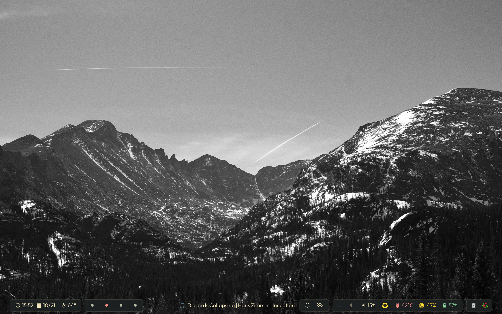
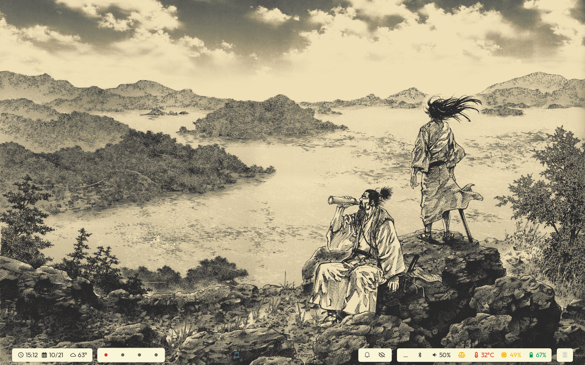
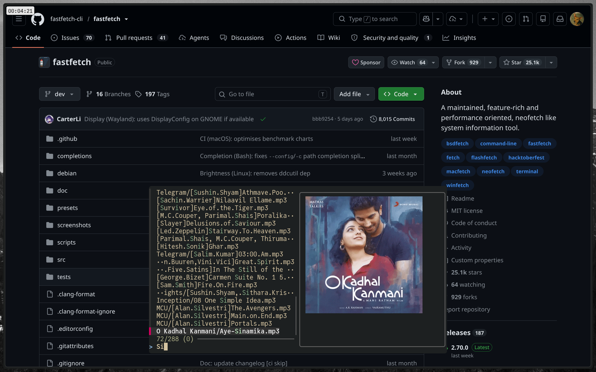
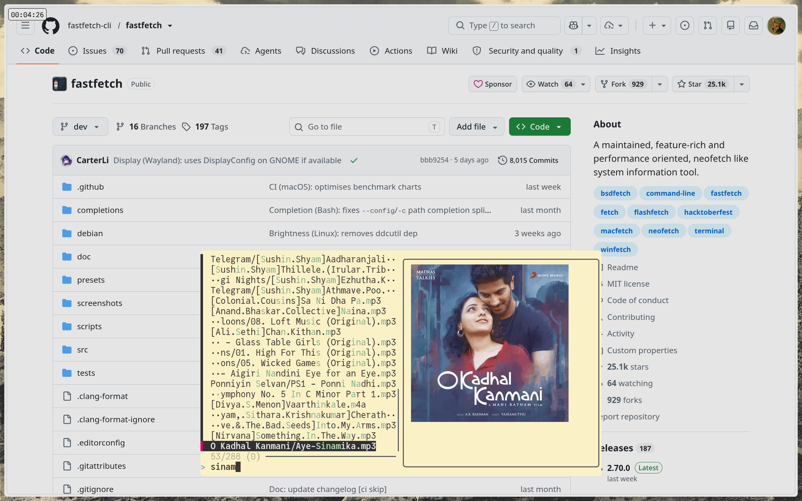
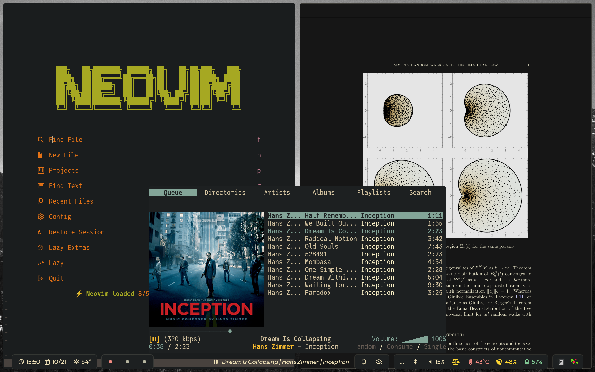
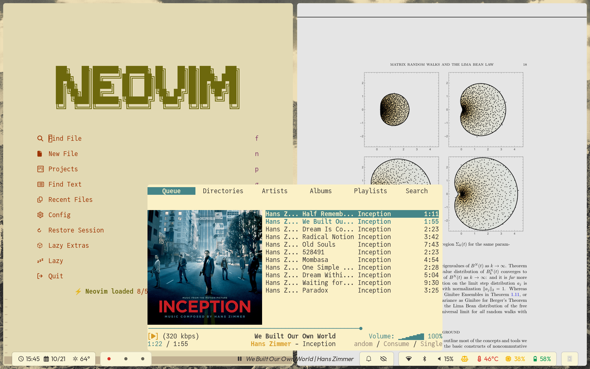

# Dotfiles

My Linux desktop configuration, built around Hyprland, with dark and light
themes, a terminal music setup, and Neovim tooling for code and mathematical
writing.

## Screenshots

|                                    Dark                                     |                                    Light                                     |
| :-------------------------------------------------------------------------: | :--------------------------------------------------------------------------: |
|  |  |
|  |  |
|           |           |

## Desktop

| Component                        | Configuration                        |
| -------------------------------- | ------------------------------------ |
| Compositor                       | [Hyprland](hypr/)                    |
| Status bar                       | [Waybar](waybar/)                    |
| Launcher                         | [Wofi](wofi/)                        |
| Notifications                    | [Dunst](dunst/)                      |
| Lock screen and idle management  | [Hyprlock and Hypridle](hypr/)       |
| Wallpaper and screen temperature | [Hyprpaper and Hyprsunset](hypr/)    |
| Terminals                        | [Foot](foot/), [Kitty](kitty/)       |
| File manager                     | [Yazi](yazi/)                        |
| System monitor                   | [btop](btop/)                        |
| GTK styling                      | [GTK 3](gtk-3.0/), [GTK 4](gtk-4.0/) |

Theme files include Gruvbox light/dark variants and Tokyo Night configurations.
The [Hyprland shaders](hypr/shaders/) include reading, cinema, CRT, and other
visual effects.

## Writing and research

- **[Neovim](nvim/)** — LazyVim-based configuration with language plugins for
  LaTeX, Typst, Markdown, Neorg, and Lean.
- **[LuaSnip snippets](nvim/LuaSnip/)** — mathematical notation, environments,
  matrices, Greek letters, and writing templates.
- **[Papis](papis/)** — bibliography tooling.
- **[Sioyek](sioyek/)** and **[Zathura](zathura/)** — PDF reader configurations
  with light and dark variants.
- **[Tridactyl](tridactyl/)** and **[Surfingkeys](surfingkeys/)** —
  keyboard-driven browsing configurations.

## Music and media

| Tool                        | Role                                                     |
| --------------------------- | -------------------------------------------------------- |
| [MPD](mpd/)                 | Music server configuration, playlists, and lyrics        |
| [rmpc](rmpc/)               | Terminal music client, theme, and lyrics-fetching script |
| [ncmpcpp](ncmpcpp/)         | Alternative terminal MPD client                          |
| [mpv](mpv/)                 | Media player settings and keybindings                    |
| [WirePlumber](wireplumber/) | Bluetooth and audio-device priority settings             |

## Scripts and services

The [userscripts](userscripts/) directory contains helpers for:

- Day/night themes: `day.sh`, `night.sh`, `themeSetter.sh`, and
  `toggle-theme.sh`.
- Screenshots, screen recording, clipboard selection, and PDF history.
- Reading mode, blue light, notifications, and monitor toggles.
- Audio switching, radio selection, and player auto-pause.
- Battery notifications, note synchronization, and image-to-LaTeX workflows.

[User systemd units](systemd/user/) cover battery notifications, note
synchronization, media auto-pause, and VPN reconnection. Other configurations
include [bat](bat/), [networkmanager-dmenu](networkmanager-dmenu/), [rbw](rbw/),
and [default application associations](mimeapps.list).

## Using these dotfiles

These are personal configurations. Install the applications you want, then copy
or symlink their configuration directories individually into `~/.config/` after
backing up your existing settings.

Before using them on another machine:

- Update absolute paths and symlinks pointing into `/home/joel/` or system theme
  directories.
- Adjust monitor names, audio devices, wallpaper paths, and other
  machine-specific settings.
- Review scripts and user services before running or enabling them.
- Check the dependencies referenced by the configurations you choose to use.

The repository also includes [`backup.sh`](backup.sh); inspect it before running
it to understand its sources and destinations.
